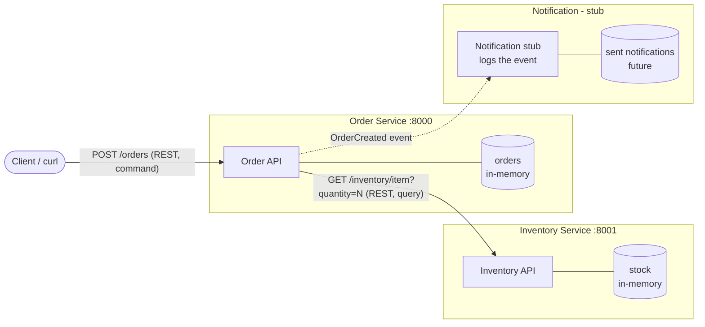

# CMPE 273 Module 4 Assignment - Order and Inventory Services

This project has two small Flask services. Each one runs as an independent process. They talk to each other with REST.
The Order Service makes new orders. Before it saves an order, it asks the Inventory Service if there is enough stock.
When an order is made, the Order Service sends an `OrderCreated` event. Right now the event just goes to a notification stub. The stub only prints it to the log.
All the data is in-memory. There is no database.

## Setup and Run

I used Windows and Git Bash. Run these commands from the repo root.

First make the venv and install the packages. You only need to do this once:

```bash
python -m venv .venv
source .venv/Scripts/activate
pip install -r requirements.txt
```

Then open one terminal for each service. Turn on the venv in each terminal.

Terminal 1 - Inventory Service (port 8001):

```bash
source .venv/Scripts/activate
python inventory_service/app.py
```

Terminal 2 - Order Service (port 8000):

```bash
source .venv/Scripts/activate
python order_service/app.py
```

The Order Service gets the Inventory Service address from the `INVENTORY_URL` environment variable. If you don't set it, it uses `http://127.0.0.1:8001`. Like this:

```bash
INVENTORY_URL=http://127.0.0.1:8001 python order_service/app.py
```

Terminal 3 - send requests with curl. For example:

```bash
curl -X POST http://127.0.0.1:8000/orders -H "Content-Type: application/json" -d '{"item_id": "apple", "quantity": 3}'
```

### Endpoints

| Service | Method | Path | What it does |
|---|---|---|---|
| Order | GET | `/health` | health check |
| Order | POST | `/orders` | make an order, body is `{"item_id": "apple", "quantity": 3}` |
| Order | GET | `/orders/<order_id>` | get an order I already made |
| Inventory | GET | `/health` | health check |
| Inventory | GET | `/inventory/<item_id>?quantity=N` | check if there are N of the item (it does not change the stock) |

The stock at the start is `apple: 10`, `banana: 5`, `laptop: 2`.

## Architecture



## Component Responsibilities

- Order Service: It gets orders from the client and checks the input. Then it asks Inventory if the item is there. If yes, it saves the order and sends an `OrderCreated` event.
- Inventory Service: It keeps the stock count for each item. It answers the question "is there enough of this item?". It is the only service that knows the stock.
- Notification (stub): This is a fake version of a Notification Service I might build later. A real one would get `OrderCreated` events and message the customer. Right now it only writes the event to the Order Service log.

## Data Ownership

| Service | Data it owns |
|---|---|
| Order Service | Orders and their status |
| Inventory Service | Stock counts for each item |
| Notification Service | Records of notifications it has sent |

No service reads or writes another service's data directly. They only use each other's API (REST) or events.
For example, the Order Service never looks at the `stock` dict. It has to call `GET /inventory/<item_id>`.

## Why These Service Boundaries

Each service does one job for the business and has its own rules and data. Because of this, I can change one service without changing the others. Also if one service fails, the others can keep running.

## Command / Query / Event

| Interaction | Type | Why |
|---|---|---|
| Check if an item is available (`GET /inventory/<item_id>?quantity=N`) | Query | It only reads data. It does not change anything. |
| Create an order (`POST /orders`) | Command | It asks the Order Service to change something. It can say no (bad input, not enough stock, unknown item). |
| Order was created (`OrderCreated`) | Event | It is something that already happened. Other services can react to it, but they can't say no to it. |

## Evidence

I copied all the output below from a real run on my computer. First both services were running. Then I stopped Inventory.

### 1. Successful order (201)

```
$ curl -s -i -X POST http://127.0.0.1:8000/orders -H "Content-Type: application/json" -d '{"item_id": "apple", "quantity": 3}'
HTTP/1.1 201 CREATED
Server: Werkzeug/3.1.9 Python/3.11.0
Date: Tue, 20 Oct 2026 04:41:49 GMT
Content-Type: application/json
Content-Length: 68
Connection: close

{"item_id":"apple","order_id":"o1","quantity":3,"status":"created"}
```

### 2. Not enough stock (409)

```
$ curl -s -i -X POST http://127.0.0.1:8000/orders -H "Content-Type: application/json" -d '{"item_id": "laptop", "quantity": 5}'
HTTP/1.1 409 CONFLICT
Server: Werkzeug/3.1.9 Python/3.11.0
Date: Tue, 20 Oct 2026 04:41:49 GMT
Content-Type: application/json
Content-Length: 75
Connection: close

{"error":"not enough stock","in_stock":2,"item_id":"laptop","requested":5}
```

### 3. Unknown item (404)

```
$ curl -s -i -X POST http://127.0.0.1:8000/orders -H "Content-Type: application/json" -d '{"item_id": "pizza", "quantity": 1}'
HTTP/1.1 404 NOT FOUND
Server: Werkzeug/3.1.9 Python/3.11.0
Date: Tue, 20 Oct 2026 04:41:49 GMT
Content-Type: application/json
Content-Length: 45
Connection: close

{"error":"item not found","item_id":"pizza"}
```

### 4. Bad input (400)

```
$ curl -s -i -X POST http://127.0.0.1:8000/orders -H "Content-Type: application/json" -d '{"item_id": "apple", "quantity": "abc"}'
HTTP/1.1 400 BAD REQUEST
Server: Werkzeug/3.1.9 Python/3.11.0
Date: Tue, 20 Oct 2026 04:41:49 GMT
Content-Type: application/json
Content-Length: 48
Connection: close

{"error":"quantity must be a positive integer"}
```

### 5. Get the created order

```
$ curl -s -i http://127.0.0.1:8000/orders/o1
HTTP/1.1 200 OK
Server: Werkzeug/3.1.9 Python/3.11.0
Date: Tue, 20 Oct 2026 04:41:49 GMT
Content-Type: application/json
Content-Length: 68
Connection: close

{"item_id":"apple","order_id":"o1","quantity":3,"status":"created"}
```

### 6. Inventory Service stopped (503), Order Service still healthy

I stopped the Inventory Service and sent another order. This is a partial failure. The Order Service gave back 503 and did not crash. Its `/health` still gave back 200.

```
$ curl -s -i -X POST http://127.0.0.1:8000/orders -H "Content-Type: application/json" -d '{"item_id": "banana", "quantity": 1}'
HTTP/1.1 503 SERVICE UNAVAILABLE
Server: Werkzeug/3.1.9 Python/3.11.0
Date: Tue, 20 Oct 2026 04:42:04 GMT
Content-Type: application/json
Content-Length: 42
Connection: close

{"error":"inventory service unavailable"}


$ curl -s -i http://127.0.0.1:8000/health
HTTP/1.1 200 OK
Server: Werkzeug/3.1.9 Python/3.11.0
Date: Tue, 20 Oct 2026 04:42:04 GMT
Content-Type: application/json
Content-Length: 34
Connection: close

{"service":"order","status":"ok"}
```

Note: On Windows, a call to a stopped service keeps trying for about 2 seconds, so the log shows `latency_ms=2011.99`. My code counts a timeout while connecting as 503, and only a slow answer from a running Inventory as 504.

### 7. Order Service logs (OrderCreated stub and the failure)

The `event=OrderCreated` line is from the notification stub. The `ERROR` line is from when Inventory was down. Every request gets one log line with the service, endpoint, status, and latency.

```
2026-10-19 21:41:49,119 INFO service=order endpoint=GET /health status=200 latency_ms=0.0
2026-10-19 21:41:49,383 INFO event=OrderCreated order_id=o1 item_id=apple quantity=3
2026-10-19 21:41:49,383 INFO service=order endpoint=POST /orders status=201 latency_ms=13.1
2026-10-19 21:41:49,526 INFO service=order endpoint=POST /orders status=409 latency_ms=19.29
2026-10-19 21:41:49,661 INFO service=order endpoint=POST /orders status=404 latency_ms=9.95
2026-10-19 21:41:49,786 INFO service=order endpoint=POST /orders status=400 latency_ms=2.07
2026-10-19 21:41:49,926 INFO service=order endpoint=GET /orders/o1 status=200 latency_ms=0.0
2026-10-19 21:42:04,390 ERROR inventory service unavailable item_id=banana
2026-10-19 21:42:04,391 INFO service=order endpoint=POST /orders status=503 latency_ms=2011.99
2026-10-19 21:42:04,509 INFO service=order endpoint=GET /health status=200 latency_ms=0.0
```

## Note on Stock Reservation

The availability check is only a query, so it does not take any stock away. This means two buyers could both see "1 laptop left" and both get an order. In a real system, Inventory would need to reserve the stock atomically so only one buyer gets the last item.

## Reflection

Clear service boundaries and data ownership are important because each service can change and deploy by itself without breaking the others. When only one service owns its data, that service is the only one that controls its rules, like only Inventory decides what "in stock" means. If services shared the same database tables, a small change in one service could break another service. Clear boundaries also stop one failure from spreading. In my test, when the Inventory Service was down, the Order Service still ran, answered `/health` with 200, and returned a 503 for new orders.
